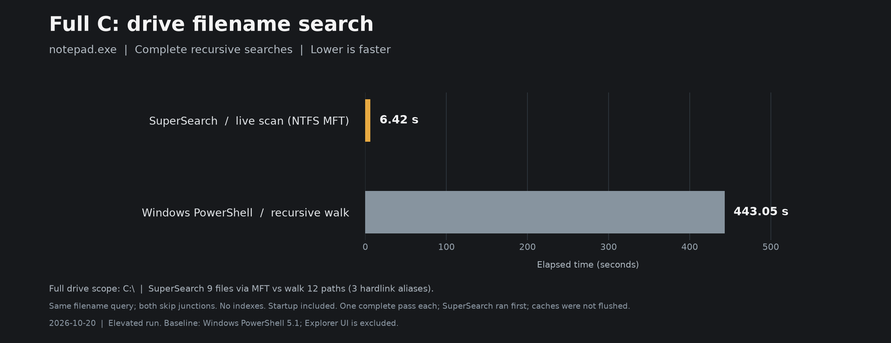
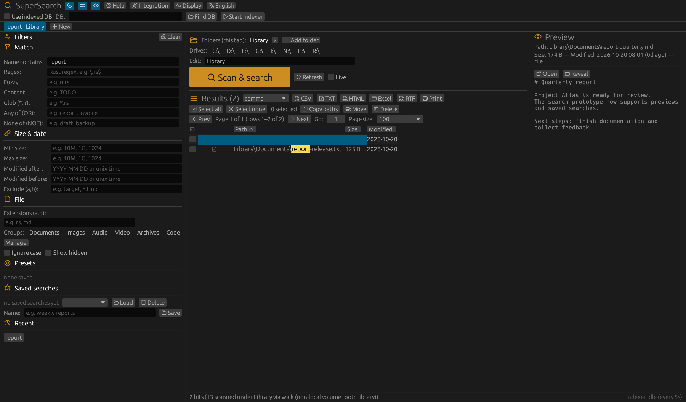
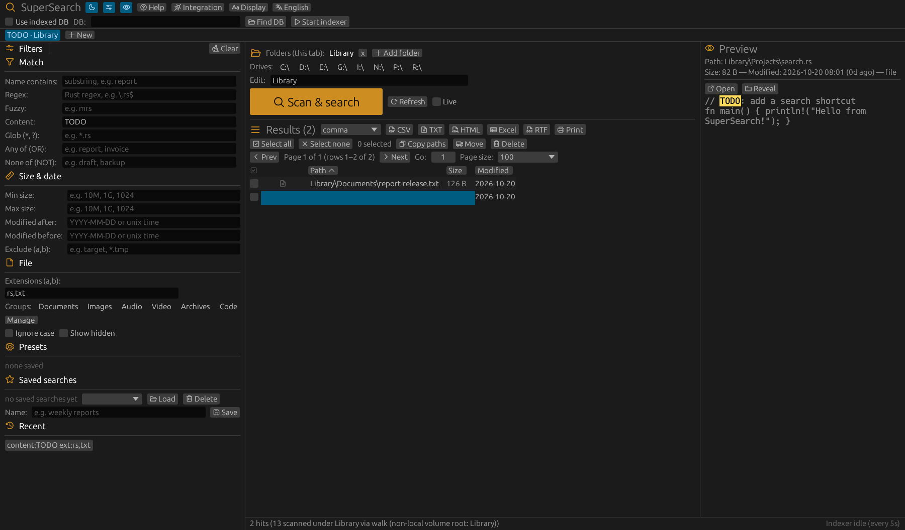

# SuperSearch

**Super fast file search. Find it, preview it, get on with your day.**

A desktop file finder and command-line tool built in Rust. Search folders or drives, narrow down the results, and jump straight to what you need.

**Windows download:** [SuperSearch v1.0.0 — 64-bit ZIP](https://github.com/RazvanManolache/SuperSearch/releases/download/v1.0.0/SuperSearch-v1.0.0-windows-x64.zip). Extract it and run `supersearch-gui.exe`; the archive also includes the `supersearch.exe` CLI. No Rust installation is needed. [Release notes and checksums](https://github.com/RazvanManolache/SuperSearch/releases/tag/v1.0.0).



*Full `C:\` search for `notepad.exe`, elevated: SuperSearch found 9 files in 6.42 s via the NTFS MFT fast path; the Windows PowerShell recursive walk found 12 paths in 443.05 s. One complete pass each, process startup included; both skipped directory junctions and caches weren't flushed (SuperSearch ran first). All 9 SuperSearch paths appear in the baseline set — the 3 extra baseline paths are NTFS hardlink aliases of the same files. The baseline is Windows PowerShell's recursive file search, not the File Explorer interface. [Results and conditions](docs/benchmarks/search-comparison.json) · [Reproduce in PowerShell 7](docs/benchmarks/measure-search.ps1).*



## Why SuperSearch?

- **Flexible search** — names, wildcards, regex, fuzzy matching, and text inside files.
- **Useful filters** — combine file types, size, dates, and exclusions.
- **Independent tabs** — keep different folders and searches side by side.
- **Quick previews** — read text snippets, see highlighted matches, then open or reveal a file.
- **Less repetition** — save searches and reuse recent filters and remembered folders.
- **Easy exports** — copy paths or export CSV, text, HTML, RTF, and Excel-readable XML spreadsheets.
- **Make it yours** — light/dark themes, adjustable interface size, and a multilingual interface.

## How it works — and why it's fast

- **Skip the folder walk on NTFS:** running as administrator lets SuperSearch read filename records directly from the drive's Master File Table, instead of opening every folder to discover its files.
- **Do less disk work:** the NTFS path rejects filename non-matches before fetching file details. For name-only CLI searches that print paths, it can skip individual size/date lookups entirely.
- **Share the work:** folder scanning uses parallel directory readers, and the NTFS search processes batches of records across CPU threads. Other filesystems and network paths automatically use folder scanning.
- **Reuse what you've scanned:** an optional SQLite index stores paths and metadata. Indexed mode loads those records and applies filters in memory; file contents are read only when requested.
- **Update incrementally:** the optional background indexer uses Windows change tracking where available, with periodic scans as a fallback. Full syncs clear deleted entries.

Content searches read the first **1 MiB** of each candidate file; contents aren't stored in the index.

### Compared with regular Windows Search

| When you're searching… | SuperSearch | Windows Search / File Explorer |
| --- | --- | --- |
| File names across a local NTFS drive | Can read the drive's filename records directly, with administrator access. | Uses its index for covered locations; other locations can require folder enumeration. |
| A folder you haven't indexed | Scan it immediately; no index setup required. | Performance depends on index coverage and whether Explorer must inspect files directly. |
| Text inside files | Reads matching candidate files during the search, up to 1 MiB each. | Can query previously indexed document text and properties using supported file-type handlers. |
| A saved file catalog | Loads its local metadata index and filters records in memory. | Queries a maintained index of names, properties, and supported content. |

The expected advantage is strongest for filename searches on local NTFS drives **when the administrator-only MFT fast path is available**. Regular folder scans still need to traverse the directory tree. Windows Search can already be very fast in indexed locations, especially for document contents. Timings depend on the drive, filters, cache, and index state. See Microsoft's [indexing guide](https://support.microsoft.com/en-us/windows/experience/performance-optimization/search-indexing-in-windows) and [Windows Search overview](https://learn.microsoft.com/en-us/windows/win32/search/-search-3x-wds-overview) for its indexing behavior.

## Get started

With a current stable Rust toolchain installed, run from the project folder:

```sh
cargo build --release --workspace --locked
cargo run --release -p supersearch-gui
```

- Built apps live in `target/release/`: `supersearch-gui` and `supersearch` (`.exe` on Windows).
- Linux desktop builds need the development libraries for your X11/Wayland environment.
- Only need the terminal? Build with `cargo build --release -p supersearch-cli --locked`.

## Try a search

- Click **Add folder**, enter a filter, and press **Enter** or **Scan & search**.
- Select a result to preview it; use **Open** or **Reveal** to jump to it.
- Enable **Live** to search as you edit, or **+ New** for another tab.

A few ideas:

- **Reports:** set **Name contains** to `report`.
- **Unfinished work:** set **Content** to `TODO` and **Extensions** to `rs,py,js,ts`.
- **Large videos:** choose **Video** and set **Min size** to `1GB`.
- **Less clutter:** add `node_modules, *.tmp` to **Exclude**.
- **Everything in a folder:** enter `*` in **Glob**.



*Screenshots use sample files rendered offscreen from the app's interface.*

## Install the CLI / add to PATH

The easiest option, from the project folder:

```sh
cargo install --path crates/supersearch-cli --locked
supersearch --help
```

- Cargo installs the CLI into its `bin` folder, normally `%USERPROFILE%\.cargo\bin` on Windows or `~/.cargo/bin` on Linux. Rust setup usually adds this to **PATH**, the list of folders your terminal searches for commands.
- If `supersearch` isn't found, add that folder to PATH using the steps below.
- To install the desktop command too, run `cargo install --path crates/supersearch-gui --locked`, then launch `supersearch-gui`.
- Without installation, use `.\target\release\supersearch.exe` in PowerShell or `./target/release/supersearch` on Linux.

<details>
<summary><strong>Windows: add a folder to PATH</strong></summary>

- For Cargo installs, use `%USERPROFILE%\.cargo\bin`. For portable builds, copy the executables to a permanent folder such as `C:\Tools\SuperSearch` and use that folder instead.
- Search the Start menu for **Edit environment variables for your account**.
- Under **User variables**, select **Path → Edit → New**, add the folder, and save with **OK**. Add the folder, not the `.exe` file.
- Restart your terminal application. If it opens inside another app, restart that app too; already running apps keep their old PATH.
- Check with `Get-Command supersearch` and `supersearch --version`.

For the current PowerShell session only (adjust the folder to your installation):

```powershell
$env:Path += ";C:\Tools\SuperSearch"
```

</details>

<details>
<summary><strong>Linux: add a folder to PATH</strong></summary>

For a Cargo install, add this line to your shell startup file (`~/.bashrc` for Bash or `~/.zshrc` for Zsh):

```sh
export PATH="$HOME/.cargo/bin:$PATH"
```

For portable builds, copy the binaries into `~/.local/bin` instead:

```sh
mkdir -p "$HOME/.local/bin"
install -m 755 target/release/supersearch target/release/supersearch-gui "$HOME/.local/bin/"
export PATH="$HOME/.local/bin:$PATH"
```

Add that last `export` line to your shell startup file to keep it across sessions. Open a new terminal and check with `command -v supersearch` and `supersearch --version`.

</details>

## CLI commands

| Command | What it does |
| --- | --- |
| `search` | Find files using folders, an index, or both. |
| `scan <folder>` | Scan a folder tree; add `--db index.db` to save an index. |
| `daemon` | Keep an index updated while the command is running; stop with **Ctrl+C**. |
| `open <path>` | Open a file or folder with its default application. |
| `reveal <path>` | Show a result in your file manager. |
| `copy-path <path>` | Copy a full path to the clipboard and print it. |
| `config show / path / reset` | View settings, locate the config file, or replace settings with defaults. |

### Everyday examples

After adding the CLI to PATH, these work from any folder. Examples use PowerShell; on Linux, use paths such as `"$HOME/Documents"`.

```powershell
# Find reports directly, ignoring case
supersearch search --root "$HOME\Documents" --live --name report --ignore-case

# Search several folders with wildcards
supersearch search --root ./docs --root ./notes --live --glob "*.md"

# Find TODOs in source files, skipping build output
supersearch search --root . --live --content TODO --ext rs --ext py --exclude target

# Find videos larger than 1 GB, modified after a date (CLI sizes are bytes)
supersearch search --root "$HOME\Videos" --live --group Video --min-size 1000000000 --modified-after 2026-01-01

# Create an index, then export matching results
supersearch scan "$HOME\Documents" --db index.db
supersearch search --db index.db --name report --ignore-case --format csv > reports.csv

# Update the index before searching
supersearch search --db index.db --root "$HOME\Documents" --fresh --name report

# Keep the index updated; leave this running in another terminal
supersearch daemon --root "$HOME\Documents" --db index.db --interval-secs 5

# Open a result, show its folder, or copy its path
supersearch open "./docs/report.txt"
supersearch reveal "./docs/report.txt"
supersearch copy-path "./docs/report.txt"
```

<details>
<summary><strong>Search options and remembered settings</strong></summary>

| Option | Use it for |
| --- | --- |
| `--name report` | Match text anywhere in the path. |
| `--glob "*.pdf"`, `--regex '\.pdf$'`, `--fuzzy rpt` | Match wildcards, a regular expression, or a fuzzy filename pattern. |
| `--content TODO` | Search text inside files. |
| `--ext rs --ext md`, `--group Documents` | Choose extensions or a file group. Groups include Documents, Images, Audio, Video, Archives, and Code. |
| `--min-size 1024`, `--max-size 1000000` | Set inclusive size limits in **bytes**; GUI size suffixes such as `1GB` don't apply here. |
| `--modified-after 2026-01-01`, `--modified-before 2026-10-01` | Filter modification times; dates mean UTC midnight, and Unix timestamps also work. Bounds are strict. |
| `--exclude target --exclude "*.tmp"` | Skip paths by substring or wildcard. |
| `--or report --or invoice`, `--not draft` | Require any listed term, or rule out a term. |
| `--ignore-case` | Ignore case for name, regex, content, wildcard, and exclusion matching. |
| `--include-hidden`, `--follow-symlinks`, `--limit 100` | Include hidden files, follow links while scanning, or cap output (`0` means unlimited). |
| `--format json`, `--format csv --csv-delim semicolon` | Export results. Formats: `text`, `csv`, `json`, `html`, `rtf`, `xlsx` (Excel XML, rather than a modern `.xlsx` workbook). |

- Filters combine: a result must meet all selected conditions. Repeated `--ext` values allow any listed extension; exclusions always win. Name matching is case-sensitive by default; extensions are always case-insensitive.
- `--live --root <folder>` skips indexes and scans current files. `--fresh --db index.db --root <folder>` updates an index before searching. These modes are mutually exclusive.
- Successful scans and searches remember folders and the database path. Omitted options reuse those settings; an index and explicit or remembered folders can be searched together.
- Use `supersearch config show` to inspect settings or `supersearch config path` to locate the file. Windows uses `%APPDATA%\supersearch\config.json`; Linux uses `$XDG_CONFIG_HOME/supersearch/config.json` or `~/.config/supersearch/config.json`.
- Use `supersearch --config ./settings.json search ...` for separate settings, or `SUPERSEARCH_CONFIG_DIR` to change the default config directory.
- Get help with `supersearch --help` or `supersearch <command> --help`. **Ctrl+C** cancels a running scan, search, or daemon.

</details>

## Contributing

Ideas, bug reports, and improvements are welcome. Run `cargo test --workspace --locked` to check your changes.
